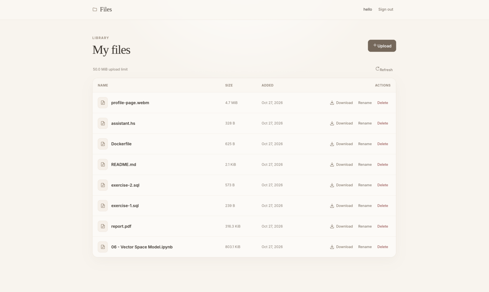
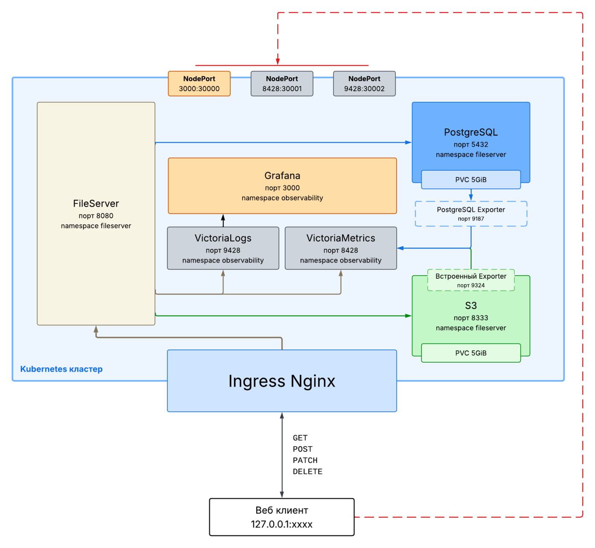

# SRE-F26 Проект: FileServer

Небольшой файловый сервер с аутентификацией по пользовательскому имени и паролю с логикой на Go и пользовательским интерфейсом HTML/CSS/JavaScript. Пользователи могут просматривать, загружать, переименовывать и удалять свои файлы. Для хранения пользовательских данных, метаданных файлов, сессий и ограничений на запросы используется PostgreSQL. Файлы сохраняются в локальном S3-совместимом хранилище (ограничение: до 50 MiB на файл).



## Архитектура

### Стек реализации

**Back-end:** Go _(`net/http`, `pgx/v5`, `goose`, `minio-go`)_  
**Front-end:** HTML, CSS, JavaScript  
**Хранилище:**
- PostgreSQL _(пользовательские данные, метаданные файлов, данные сессии)_
- SeaweedFS _(данные файлов)_

**Логирование:** Vector _(сбор и отправка)_, VictoriaLogs _(хранение и запросы)_  
**Метрики:** VictoriaMetrics _(сбор и хранение)_  
**Визуализация:** Grafana

**Контейнеризация:** Docker  
**Оркестрация:** Kubernetes / Docker Compose

### Диаграмма



## Запуск

### Kubernetes

**Требования:** Minikube 1.39.0+, Helm, Docker, Make, Python3.

#### Первый запуск
`scripts/install.sh`:
- Проверяет наличие требуемых компонентов
- Активирует виртуальное окружение Python3 и подгружает зависимости
- Запускает Minikube с пробросом портов для Ingress, VictoriaMetrics, VictoriaLogs, Grafana
- Собирает Docker-образ и подгружает его в Minikube
- Вызывает `make k8s-apply`

```bash
bash scripts/install.sh
```

#### Применение новых манифестов
_Для применения манифестов Minikube должен быть запущен скриптом `scripts/install.sh`._

```bash
source .venv/bin/activate
make k8s-apply
```

#### Сборка и загрузка нового изображения
```bash
make k8s-update-image
```

### Docker Compose

**Требования:** Docker Engine, Docker Compose v2+, Make, Python 3 _(для генерации `.env`)_, Go 1.26+ _(для тестов)_.

```bash
# Генерируем .env со случайными данными (выходит, если .env уже существует)
make setup

# Собираем и запускаем в Docker Compose
make up
```
