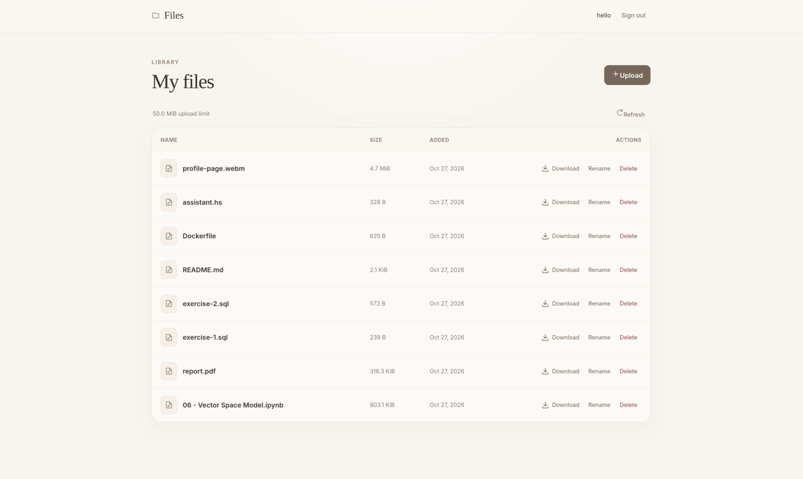
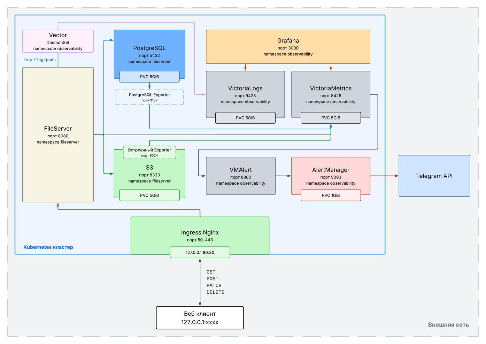

# SRE-F26 Проект: FileServer

Небольшой файловый сервер с аутентификацией по пользовательскому имени и паролю с логикой на Go и пользовательским интерфейсом HTML/CSS/JavaScript. Пользователи могут просматривать, загружать, переименовывать и удалять свои файлы. Для хранения пользовательских данных, метаданных файлов, сессий и ограничений на запросы используется PostgreSQL. Файлы сохраняются в локальном S3-совместимом хранилище (ограничение: до 50 MiB на файл).



## Архитектура

### Стек реализации

**Back-end:** Go _(`net/http`, `pgx/v5`, `goose`, `minio-go`)_  
**Front-end:** HTML, CSS, JavaScript  
**Хранилище:**
- PostgreSQL _(пользовательские данные, метаданные файлов, данные сессии)_
- SeaweedFS _(данные файлов)_

**Логирование:** Vector _(сбор и отправка)_, VictoriaLogs _(хранение и запросы)_  
**Метрики:** VictoriaMetrics _(сбор и хранение)_  
**Визуализация:** Grafana

**Контейнеризация:** Docker  
**Оркестрация:** Kubernetes

### Диаграмма



## Запуск

**Требования:** Bash, Minikube 1.39.0+, Helm, Docker, Make, Python3.

### Первый запуск

`scripts/install.sh`:
- Проверяет наличие требуемых компонентов
- Создаёт виртуальное окружение Python и устанавливает необходимые зависимости
- Запускает Minikube с пробросом HTTP-порта для Ingress
- Собирает Docker-образ и подгружает его в Minikube
- Вызывает `make k8s-deploy`

**Важно:**
- Для генерации секретов Alertmanager требуются Telegram **токен бота** и **ID чата** _([инструкция](https://sitogon.ru/blog/252-kak-sozdat-telegram-bot-poluchit-ego-token-i-chat-id))_.
- Установочный скрипт запросит их из **стандартного ввода**.

```bash
bash scripts/install.sh
```

#### Доступ к внутренним сервисам

| Сервис            | Команда для проброса порта                                                                                |
|-------------------|-----------------------------------------------------------------------------------------------------------|
| Grafana           | `minikube kubectl -- -n observability port-forward svc/grafana 3000:3000`                                 |
| VictoriaLogs      | `minikube kubectl -- -n observability port-forward svc/victorialogs 9428:9428`                            |
| VictoriaMetrics   | `minikube kubectl -- -n observability port-forward svc/vmsingle-victoria-metrics-single-server 8428:8428` |
| VMAlert           | `minikube kubectl -- -n observability port-forward svc/vmalert 8880:8880`                                 |
| Alertmanager      | `minikube kubectl -- -n observability port-forward svc/alertmanager 9093:9093`                            |

### Применение новых манифестов

_Для применения манифестов в корне проекта должна находиться директория `.venv`, содержащая все модули из `scripts/requirements.txt`._

```bash
make k8s-deploy
```

### Сборка и загрузка нового изображения

```bash
make k8s-update-image
```

### Обслуживание

- **Очистка** - удаление истёкших сессий, ограничений запросов и незавершённых файловых операций. Автоматически выполняется каждые 15 минут.
- **Аудит** - проверка согласованности метаданных PostgreSQL и объектов S3 без удаления данных.

Ручной запуск:

```bash
make maintenance-cleanup
make maintenance-audit
```

## Тестирование

### Проверка кода

Проверка форматирования Go, статический анализ (`go vet`), запуск Go-тестов и Python unit-тестов.

```bash
make check
```

### Пробер

- **Позволяет протестировать систему под _нормальной_ нагрузкой** - 1 worker шлёт не более одного запроса в секунду.
- **Провести стресс-тестирование** - 16 worker'ов параллельно делают запросы без задержек между двумя последовательными запросами.

```bash
make probe MODE=normal                          # 1 worker, файл 4 KiB
make probe MODE=stress TARGET_URL=127.0.0.1     # 16 worker'ов, файл 8 MiB
```
