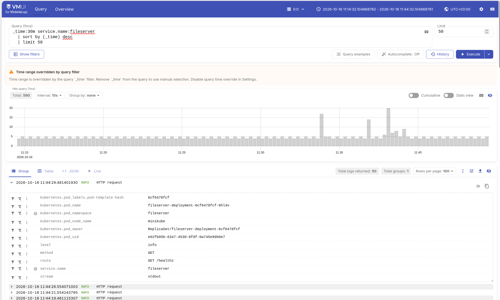
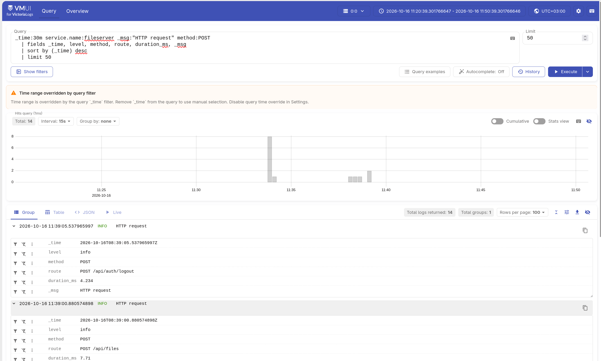
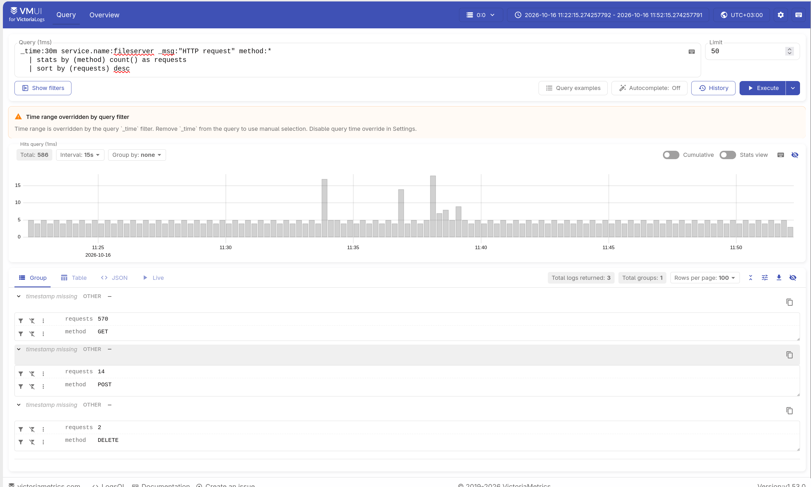
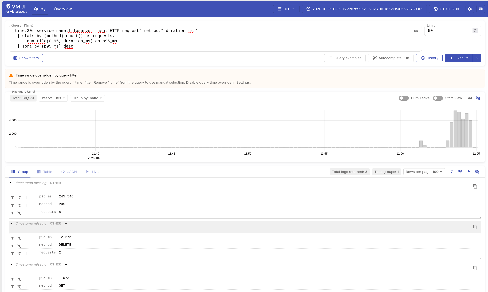
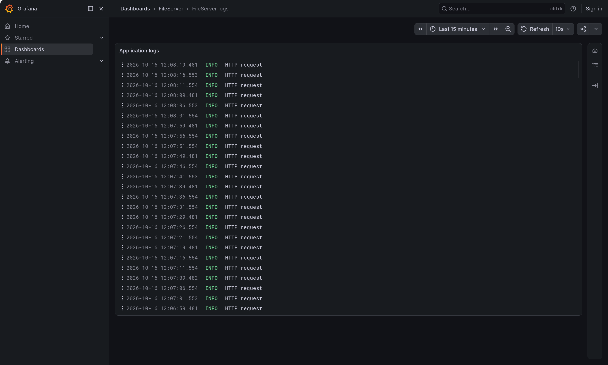

# Домашнее задание III: VictoriaLogs

## Доставка логов

Для доставки логов используется Vector, запущенный как DaemonSet. Он читает логи контейнеров из `/var/log/pods`, разбирает JSON и отправляет записи в VictoriaLogs. Такой подход позволяет собирать логи разных Pod одним агентом на узле, не добавляя sidecar в каждую реплику приложения и не реализуя отправку логов в самом приложении.

## Запросы в `vmui`

### 1. Сырые записи за последние 30 минут

```logsql
_time:30m service.name:fileserver
  | sort by (_time) desc
  | limit 50
```

Запрос возвращает до 50 последних записей FileServer за последние 30 минут.



### 2. Фильтрация по полю HTTP-метода

```logsql
_time:30m service.name:fileserver _msg:"HTTP request" method:POST
  | fields _time, level, method, route, duration_ms, _msg
  | sort by (_time) desc
  | limit 50
```

Запрос возвращает поля `_time`, `level`, `method`, `route`, `duration_ms`, `_msg` до 50 последних записей обработки POST-запросов



### 3. Количество HTTP-запросов с группировкой по методу

```logsql
_time:30m service.name:fileserver _msg:"HTTP request" method:*
  | stats by (method) count() as requests
  | sort by (requests) desc
```

Запрос группирует записи по HTTP-методу, выполняет подсчёт по методу, после чего сортирует ряды по количеству запросов.



### 4. P95 времени обработки HTTP-запросов по методу

```logsql
_time:30m service.name:fileserver _msg:"HTTP request" method:* duration_ms:*
  | stats by (method) count() as requests,
      quantile(0.95, duration_ms) as p95_ms
  | sort by (p95_ms) desc
```

Запрос группирует записи по HTTP-методу, подсчитывает количество запросов каждого метода и P95 времени обработки запросов этого метода, после чего сортирует группы по P95 в убывающем порядке. Фильтр `duration_ms` отсеивает записи без измерения длительности.



## Grafana

Grafana подключена к VictoriaLogs через официальный плагин `victoriametrics-logs-datasource`. Дашборд `FileServer logs` отображает логи приложения по запросу `service.name:fileserver` с обновлением каждые 10 секунд.


