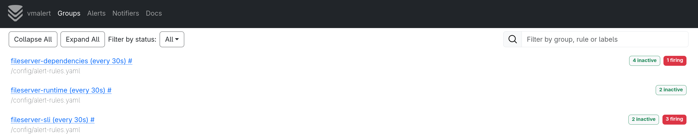
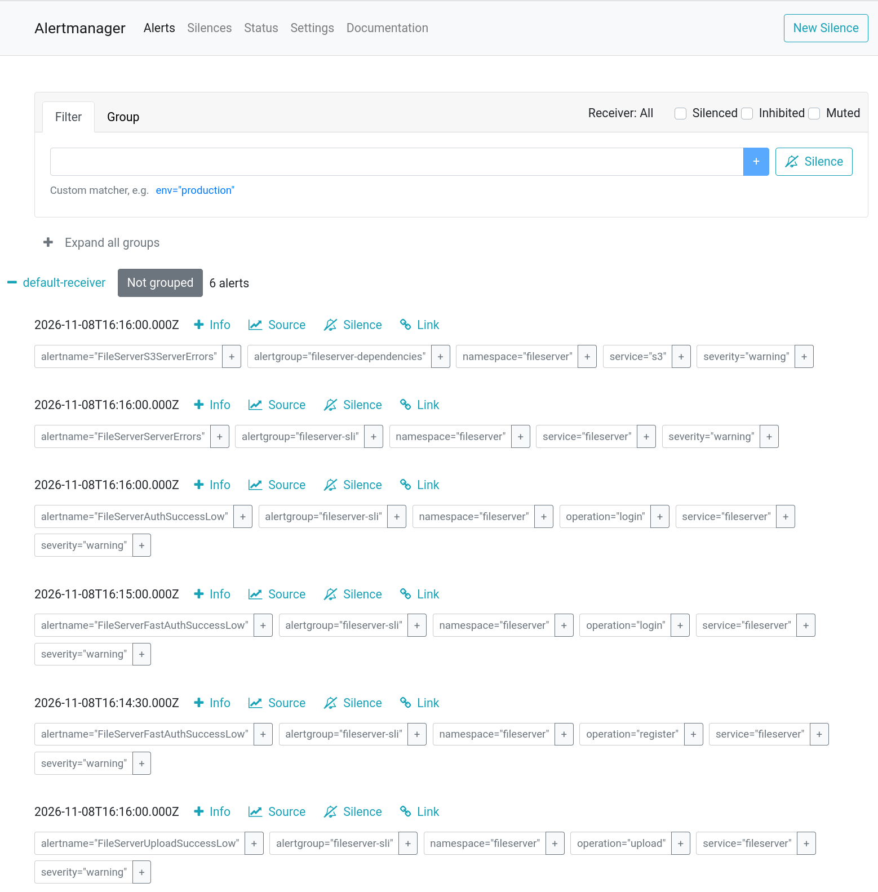
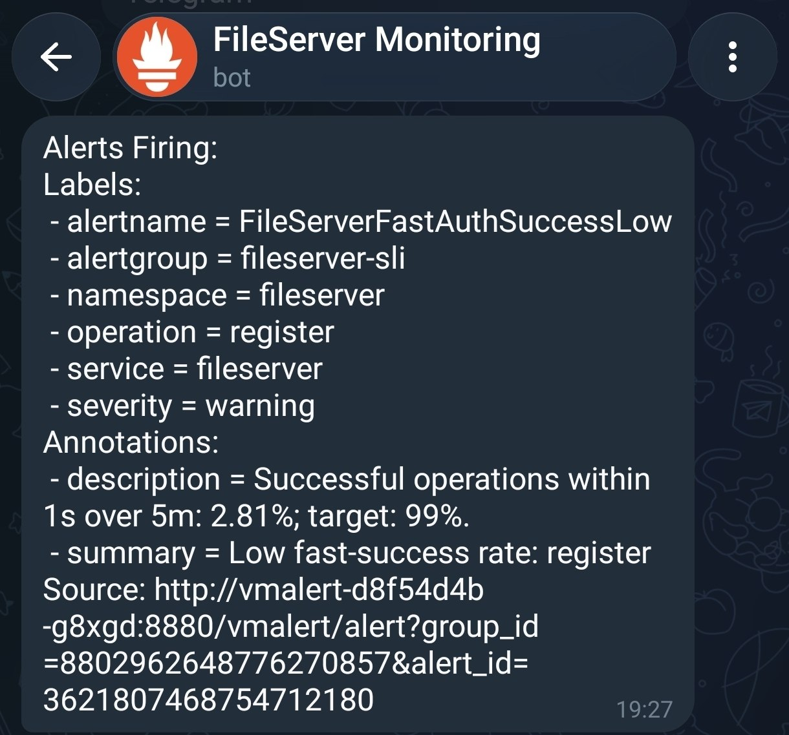

# Домашнее задание VI: Alertmanager

## Алерты

- Правила проверяются каждые 30 секунд.
- Уведомления о срабатывании отправляются в [Telegram](https://t.me/fileserver_monitoring_bot).

### На метрики сервиса

#### FileServer

| Алерт | Описание | Обоснование выбора |
|--------|---------|--------------------|
| `FileServerAuthSuccessLow` | Менее 99% успешных авторизаций и регистраций за 5 минут | Позволяет обнаруживать проблемы с аутентификацией |
| `FileServerUploadSuccessLow` | Менее 99.5% успешных загрузок файлов за 5 минут | Позволяет обнаруживать проблемы с сохранением файлов |
| `FileServerSessionDownloadSuccessLow` | Менее 99.9% успешных выходов из аккаунта и скачиваний файлов за 5 минут | Позволяет обнаруживать проблемы с завершением сессий и скачиванием файлов |
| `FileServerFastAuthSuccessLow` | Менее 99% авторизаций и регистраций завершаются успешно за 1 секунду | Позволяет обнаруживать деградацию скорости и успешности аутентификации |
| `FileServerServerErrors` | Не менее 3 ответов HTTP 5xx за 5 минут | Позволяет обнаруживать внутренние ошибки приложения |

- Для первых четырёх алертов требуется минимум 5 операций за 5 минут, чтобы избежать срабатываний при недостаточном количестве запросов.
- Все пять алертов имеют `for: 2m`.

### На метрики runtime

| Алерт | Описание | Обоснование выбора |
|--------|---------|--------------------|
| `FileServerMemoryHigh` | Использование более 400 MiB физической памяти (`process_resident_memory_bytes`) | Позволяет обнаруживать чрезмерное потребление памяти при лимите контейнера 512 MiB |
| `FileServerGoroutinesHigh` | Более 200 goroutines (`go_goroutines`) | Позволяет обнаруживать возможные утечки goroutines и чрезмерную конкурентность |

- Для обоих алертов используется `for: 5m`, чтобы исключить срабатывания при кратковременных скачках потребления ресурсов.

### На метрики зависимостей

#### SeaweedFS (S3)

| Алерт | Описание | Обоснование выбора |
|--------|---------|--------------------|
| `FileServerS3ServerErrors` | Не менее 3 ответов HTTP 5xx за 5 минут | Позволяет обнаруживать внутренние ошибки S3 |
| `FileServerS3MetadataSlow` | P95 времени операций с метаданными LevelDB2 превышает 100 мс при минимум 20 операциях за 5 минут | Позволяет обнаруживать деградацию производительности хранилища |
| `FileServerS3ReadOnlyVolumes` | Наличие хотя бы одного тома в режиме read-only | Позволяет обнаруживать проблемы с записью файлов |

- Для первых двух алертов используется `for: 2m`, чтобы исключить кратковременные ошибки и задержки.
- Для `FileServerS3ReadOnlyVolumes` используется `for: 1m`, поскольку недоступность записи требует более быстрой реакции.

#### PostgreSQL

| Алерт | Описание | Обоснование выбора |
|--------|---------|--------------------|
| `FileServerPostgresDeadlocks` | Хотя бы один deadlock за 10 минут | Позволяет обнаруживать проблемы с конкурентным выполнением транзакций |
| `FileServerPostgresUnavailable` | `pg_up == 0` в течение минуты | Позволяет обнаруживать потерю подключения экспортёра к PostgreSQL |

- Для обоих алертов используется `for: 1m`, чтобы обеспечить быструю реакцию на проблемы с базой данных.

## Сработавшие алерты

### Группы VMAlert

### Alertmanager UI

### Уведомление в Telegram

